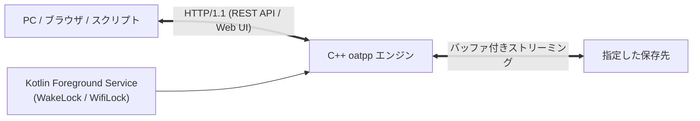

# AndroServer ⚡

リリース APK は [`_dl/<バージョン番号>/`](_dl/README.MD) に配置します。最新： [1.0.1](_dl/1.0.1/README.MD)。

Android 端末上で動作する、高速・軽量な HTTP / REST ファイル転送サーバーです。
バックエンドに **C++ (oatpp フレームワーク)** を採用し、フォアグラウンドサービスによるバックグラウンド常駐、大容量ストリーミングI/O、HTTP Range対応（レジューム/並列転送）によって、Wi-Fi／有線LAN経由でファイルを転送します。

さらに、PC等のブラウザからアクセスするだけでドラッグ＆ドロップでファイル送受信ができる **モダンなWeb管理画面 (Web UI)** を内蔵しています。

---

## 主な特徴

- 🚀 **C++ (oatpp) によるストリーミング**
  - アップロードには 256 KiB のバッファを使用。
  - `posix_fadvise`（先読み最適化）によるシーケンシャル読み込み高速化。
- 📦 **充実のファイル管理機能**:
  - 大容量ファイルのダウンロード / アップロード
  - HTTP `Range` リクエスト対応（レジューム・複数コネクション並列転送）
  - ディレクトリ一覧取得（JSON）
  - ディレクトリ作成 (`mkdir -p` 相当)
  - ファイル・フォルダの再帰的削除
- 🌐 **内蔵 Web UI**:
  - PC側のブラウザで `https://<AndroidのIP>:8080/` を開き、アプリで指定したユーザー名とパスワードで接続。
  - ドラッグ＆ドロップアップロード、進捗率・転送速度（MB/s）リアルタイム表示。
- 🔋 **Android 最適化 & 安定動作**:
  - `Foreground Service` による常駐実行。
  - 稼働中に Android がプロセスを終了した場合、起動時の設定を使ってサービスを自動復旧。復旧時に LAN が未接続でも、接続後は既存の5秒間隔の監視で待ち受けを再開します。手動の「停止」後は復旧しません。OS の強制停止や端末独自の省電力制限では復旧できない場合があります。実機でのスリープ復帰動作は未確認です。
  - `WakeLock`（CPUスリープ防止）および `WifiLock (HIGH_PERF)`（Wi-Fi省電力による速度低下防止）。
  - 「フォルダを追加」から端末内の複数フォルダを公開。Android のファイルアクセス権限が必要。
  - パストラバーサル防止によるセキュリティ対策。

---

## アーキテクチャ



---

## ビルド・導入手順

### 前提環境
- **Android Studio** (Hedgehog / Iguana / Jellyfish 以降推奨)
- **Android SDK** (API 26〜34)
- **Android NDK** (r25c 以降推奨, CMake 3.22.1+)

### セットアップ
1. 本リポジトリを Android Studio で「Open」します。
2. Android Studio の SDK Manager より `NDK (Side by side)` および `CMake` がインストールされていることを確認します。
3. 初回ビルド時、CMake の `FetchContent` によって oatpp (v1.3.0) が自動ダウンロード・静的リンクされます。
4. 実機に転送して実行します。
5. ユーザー名とパスワードを入力し、「フォルダを追加」から公開フォルダを1つ以上指定して起動します。フォルダの選択時に Android のファイルアクセス権限を許可してください。「設定を保存し、端末の起動時に開始」をオンにして一度起動すると、パスワードを含む設定を Android Keystore の鍵で暗号化して保存します。再起動後の初回ロック解除で自動起動し、LAN 接続を最大60秒待ちます。スイッチをオフにすると保存した起動設定を削除します。

---

## 無線 LAN で HTTPS を使う

1. Android の Wi-Fi 設定で IPv4 アドレスを確認します。証明書の SAN にその IP アドレスが必要です。
2. 秘密鍵と証明書チェーンが入った PKCS#12 ファイル（`.p12` または `.pfx`）を用意します。Android からアクセスできる場所に、暗号化された経路で配置してください。
3. AndroServer の「HTTPS を使う」をオンにし、証明書ファイルを選択して、そのファイルのパスワードを入力します。ファイル転送用のユーザー名とパスワードも別に入力して起動します。
4. PC の Chrome でアプリに表示された `https://` の URL を開きます。組織や自分で管理する CA を使う場合は、PC の証明書管理で、その CA の公開証明書を信頼済みルートに登録します。[Chrome の証明書管理](https://support.google.com/chrome/answer/10468685?hl=ja)

既存の証明書がない場合は OpenSSL で専用 CA とサーバー証明書を作成できます。下の例は OpenSSL 3.x 向けです。リポジトリ外の作業フォルダで実行し、`192.168.1.100` を Android の Wi-Fi IPv4 に置き換えてください。コマンドが求めるパスワードは対話入力します。

```powershell
$androidIp = "192.168.1.100"
openssl req -x509 -newkey rsa:3072 -sha256 -days 365 -keyout ca.key -out ca.crt -subj "/CN=AndroServer LAN CA" -addext "basicConstraints=critical,CA:TRUE,pathlen:0" -addext "keyUsage=critical,keyCertSign,cRLSign"
openssl req -new -newkey rsa:2048 -keyout server.key -out server.csr -subj "/CN=$androidIp"
@"
basicConstraints=critical,CA:FALSE
extendedKeyUsage=serverAuth
subjectAltName=IP:$androidIp
"@ | Set-Content -Encoding ascii server.ext
openssl x509 -req -in server.csr -CA ca.crt -CAkey ca.key -CAcreateserial -out server.crt -days 90 -sha256 -extfile server.ext
openssl pkcs12 -export -inkey server.key -in server.crt -certfile ca.crt -out androserver.p12
openssl x509 -in ca.crt -outform DER -out androserver-ca.cer
```

PC が信頼するのは公開証明書 `androserver-ca.cer` です。Android で選択するのは `androserver.p12` です。秘密鍵 `ca.key` と `server.key` は管理者の手元で保管してください。LAN の IP が変わった場合は、新しい IP でサーバー証明書を発行します。

---

## REST API 仕様 & コマンド例

ベースURLは Android アプリに表示されます。Wi-Fi／有線LAN／アクセスポイントの IPv4 アドレスを優先します。

すべての操作に HTTP Basic 認証が必要です。以下の curl コマンドのユーザー名を設定に合わせ、指定したパスワードを入力してください。HTTPS を無効にした場合、認証情報とファイルは平文で流れます。アップロードには `Content-Length` が必要です。

一覧 API をパスなしで呼ぶと公開フォルダ名が返ります。それ以外のファイル操作では `公開フォルダ名/相対パス` を指定します。以下の例では `DCIM` と `Downloads` を公開しています。

### 1. ファイル一覧取得 (GET /api/files/list)
```bash
curl --user androserver -sS "https://192.168.1.100:8080/api/files/list?path=DCIM/Camera" | jq .
```

### 2. ファイルダウンロード (GET /api/files/download)
```bash
# 通常ダウンロード
curl --user androserver -o photo.jpg "https://192.168.1.100:8080/api/files/download?path=DCIM/Camera/photo.jpg"

# レジューム / 部分ダウンロード (Rangeリクエスト)
curl --user androserver -H "Range: bytes=0-1048575" -O "https://192.168.1.100:8080/api/files/download?path=Downloads/video.mp4"
```

### 3. ファイルアップロード (POST /api/files/upload)
```bash
# ストリーミングアップロード
curl --user androserver -X POST "https://192.168.1.100:8080/api/files/upload?path=Downloads/test.bin" \
     -H "Content-Type: application/octet-stream" \
     --data-binary @local_test.bin
```

### 4. フォルダ作成 (POST /api/directories)
```bash
curl --user androserver -X POST "https://192.168.1.100:8080/api/directories?path=Downloads/MyNewFolder/SubFolder"
```

### 5. ファイル / フォルダ削除 (DELETE /api/files)
```bash
curl --user androserver -X DELETE "https://192.168.1.100:8080/api/files?path=Downloads/test.bin"
```

---

## ベンチマーク・テストクライアント

付属の Python スクリプトで、100 MiB のアップロード・ダウンロード速度（MiB/s、Mbps）を計測し、SHA-256 と末尾バイトの Range 応答を確認できます。

```bash
python scripts/test_client.py https://192.168.1.100:8080 Downloads --user androserver --ca ca.crt
```

